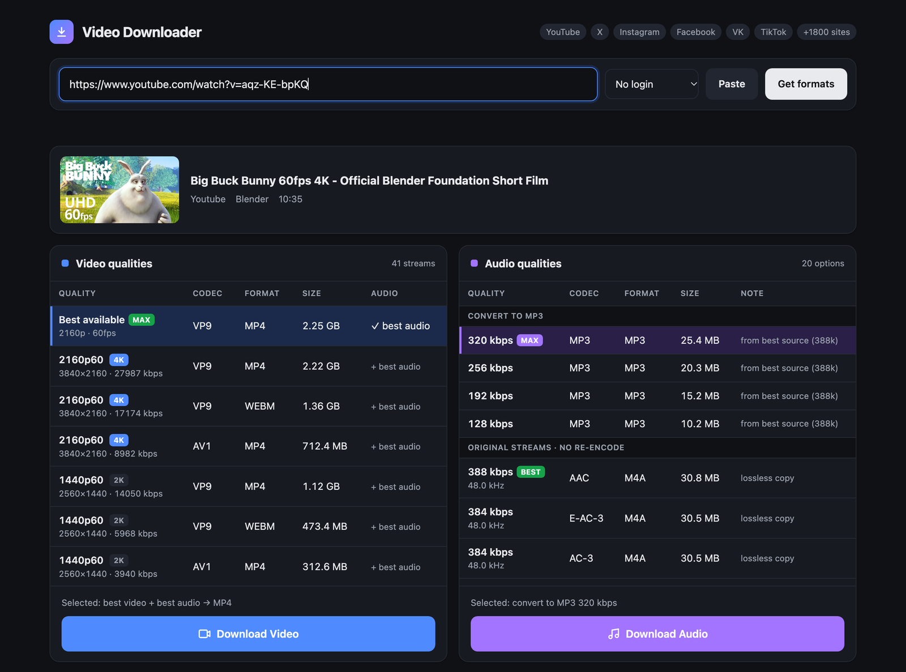

# Video Downloader

Download videos and audio from **YouTube, X (Twitter), Instagram, Facebook, VK, TikTok, Vimeo and 1800+ other sites** in the highest quality they offer, up to 4K/8K and HDR. It can also convert audio to **MP3 up to 320 kbps**.

Paste a link, pick a quality from the video or audio table, and click download.


<sub>Example video: *Big Buck Bunny* © Blender Foundation, [CC BY 3.0](https://creativecommons.org/licenses/by/3.0/).</sub>

## Download

| Platform | File | How to run |
|---|---|---|
| **macOS** (Apple Silicon M1–M4) | [VideoDownloader-macOS-AppleSilicon.zip](https://github.com/Shaf31/video-downloader/releases/latest/download/VideoDownloader-macOS-AppleSilicon.zip) | Unzip, drag **Video Downloader.app** to Applications, open it |
| **Windows** 10/11 (64-bit) | [VideoDownloader-Windows-x64.exe](https://github.com/Shaf31/video-downloader/releases/latest/download/VideoDownloader-Windows-x64.exe) | Double-click |
| **Linux** (64-bit Intel/AMD) | [video-downloader-linux-x64.tar.gz](https://github.com/Shaf31/video-downloader/releases/latest/download/video-downloader-linux-x64.tar.gz) | `tar xzf video-downloader-linux-x64.tar.gz && ./video-downloader` |

Every download is a single standalone app. Python, ffmpeg and everything else it needs are bundled inside, so there's nothing else to install.
All versions are on the [Releases](https://github.com/Shaf31/video-downloader/releases) page.

> **First launch:** the apps aren't code-signed.
> - **macOS:** if it says the app "can't be opened", right-click it, choose **Open**, then **Open** again.
> - **Windows:** if SmartScreen shows "Windows protected your PC", click **More info**, then **Run anyway**.

## Features

- **Link field.** Paste a link and the formats load on their own.
- **Video qualities table.** It lists every stream the site offers, best first (resolution, fps, codec, container, size). **Best available** is selected by default: it merges the best video with the best audio into one MP4.
- **Audio qualities table.**
  - **Convert to MP3** at 320, 256, 192 or 128 kbps, made from the best audio source.
  - **Original streams** (AAC, Opus, E-AC-3…) copied with no re-encoding, so there's no quality loss.
- **Two buttons**, Download Video and Download Audio, each with its own progress bar, speed and time left.
- **Login-only videos:** pick *Login: Chrome / Safari / Firefox / Edge / Brave* to use your browser's login. Instagram and Facebook often need this.
- **Native window** on macOS and Windows. On Linux it opens in your browser.
- Files are saved to `Downloads/Video Downloader`.

## Run from source

Requires Python 3.10+. The launchers set up a local virtual environment on first run and update the downloader engine (yt-dlp) every time they start, so sites keep working.

```bash
git clone https://github.com/Shaf31/video-downloader.git
cd video-downloader
./start.sh          # macOS / Linux
start.bat           # Windows
```

Tip: open the app with `?url=<link>` to load a link straight away.

## Build the standalone apps

**On GitHub:** go to **Actions → Build → Run workflow**. It builds macOS, Windows and Linux in parallel; download the results from the run's *Artifacts*.

**Locally** (PyInstaller can only build for the OS it runs on):

```bash
pip install -r requirements.txt pyinstaller pillow pywebview   # skip pywebview on Linux
python build.py
```

The output goes to `dist/`: `Video Downloader.app`, `Video Downloader.exe` or `video-downloader`.

## How it works

| Part | Role |
|---|---|
| [yt-dlp](https://github.com/yt-dlp/yt-dlp) | Reads the link and downloads the streams (supports 1800+ sites) |
| [ffmpeg](https://ffmpeg.org/) (via [imageio-ffmpeg](https://github.com/imageio/imageio-ffmpeg)) | Merges video and audio, converts to MP3 |
| [Deno](https://deno.com/) | JavaScript runtime that yt-dlp needs to unlock YouTube's highest qualities |
| [Flask](https://flask.palletsprojects.com/) | Local backend at `127.0.0.1`. Nothing is exposed to your network |
| [pywebview](https://pywebview.flowrl.com/) | Native app window on macOS and Windows |
| [PyInstaller](https://pyinstaller.org/) | Packs everything into standalone apps |

Project files: `app.py` (backend), `index.html` (UI), `build.py` (packaging), `start.sh` / `start.bat` (launchers), `.github/workflows/build.yml` (CI builds).

## Troubleshooting

- **A site stopped working:** sites change often. Run from source (the launchers update yt-dlp automatically), or download a newer release.
- **4K file won't play in QuickTime / Windows Media Player:** YouTube's 4K and 8K are VP9 or AV1. Use [VLC](https://www.videolan.org/), or pick an **H.264** row instead.
- **Instagram / Facebook says login required:** pick your browser in the *Login* menu and make sure you're logged in to the site there.
  - On Windows, fully close Chrome or Edge first, or use Firefox.
  - On macOS, Safari needs Full Disk Access for the app.

## Disclaimer

Only download content you own or have permission to download, and respect each site's terms of service and copyright law.
